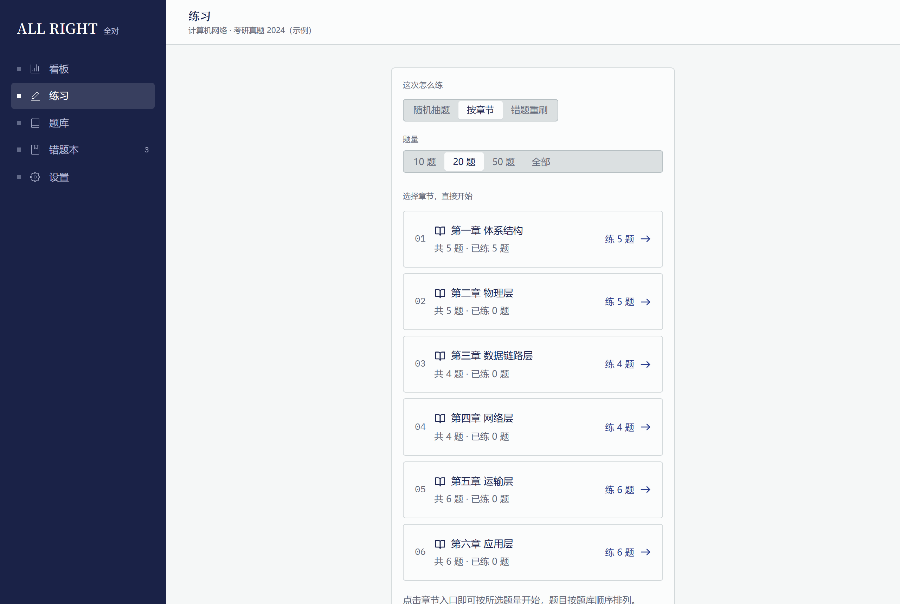
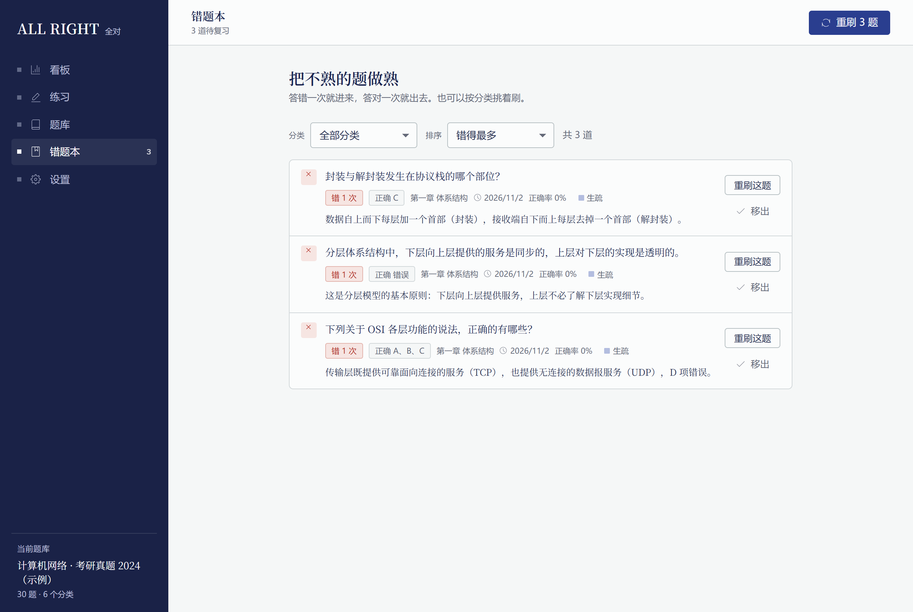
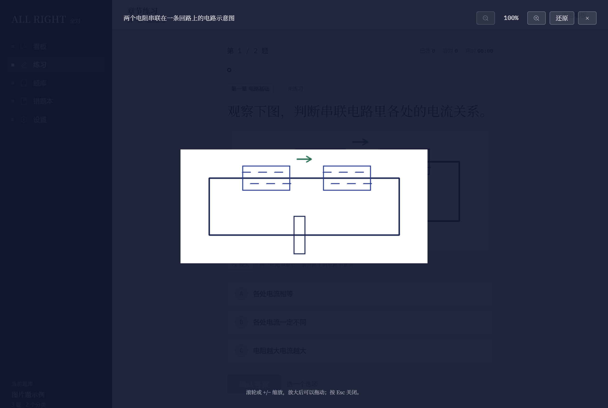
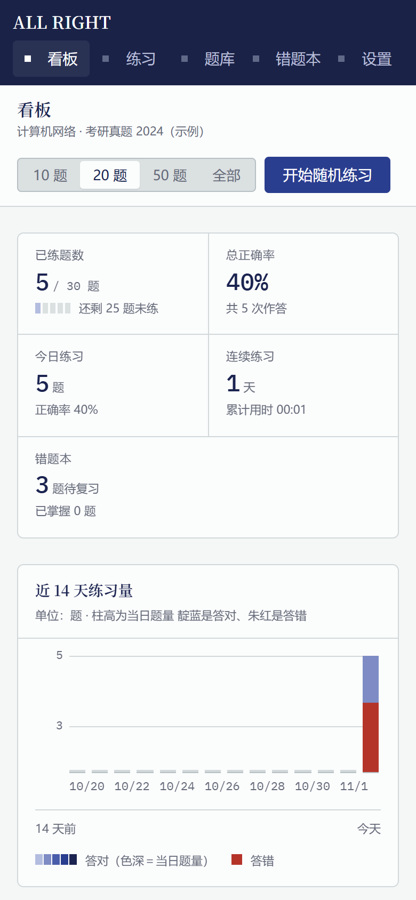

<div align="center">


# ALL RIGHT 全对

**离线电子刷题台** · 章节直达 · 错题本 · 进度看板 · 图片题

[](https://github.com/Simple-YU-268/all-right/releases/tag/v0.4.0)
[](https://github.com/Simple-YU-268/all-right/releases)
[](https://tauri.app)
[](https://github.com/Simple-YU-268/all-right)

</div>

---

把 JSON 题库导入本地，按章节或随机抽题练习，答错的题自动收进错题本随时重刷，看板集中呈现练习进度、正确率与掌握分布。

**v0.3.0 新增图片题**：题干、选项和解析都能配图，图片跟着题库包一起离线保存。

## 截图

| 看板 | 图片题 |
| :---: | :---: |
|  |  |

| 章节直达 | 错题本 |
| :---: | :---: |
|  |  |

| 图片放大 | 窄屏也能用 |
| :---: | :---: |
|  |  |

## 能做什么

| 功能 | 说明 |
| --- | --- |
| **章节直达** | 「练习 → 按章节」直接列出全部章节入口，选好题量点一下就开练 |
| **错题本** | 答错一次自动进本，答对一次自动出本，可按分类挑着刷 |
| **进度看板** | 已练题数、总正确率、近 14 天练习量、分类正确率与掌握度分布 |
| **章节管理** | 在题库页直接增删改章、批量导入多章，全部校验通过才一起保存 |
| **图片题** | 题干、选项、解析都能配图，图文交替排版，点图放大、缩放、拖动 |
| **完全离线** | 题库与练习记录只存在这台电脑上，不上传、不联网 |
| **跨端** | Windows 桌面版（Rust + Tauri 2）与网页版共用同一套 React 界面 |

界面视觉方向是「蜡纸油印卷子」：靛蓝油墨印在冷灰纸面上，答错处留一道朱红批改，答对处是石绿。字体分三个角色：宋体读题面、系统无衬线做界面、等宽读数做数据。

## 下载

Windows x64 安装包见 [Releases](https://github.com/Simple-YU-268/all-right/releases)，当前版本 **v0.4.0**，内置 MCP 无需 Node.js：

| 文件 | 说明 | 大小 |
| --- | --- | --- |
| [`ALLRIGHT-Setup-0.4.0.exe`](https://github.com/Simple-YU-268/all-right/releases/download/v0.4.0/ALLRIGHT-Setup-0.4.0.exe) | 安装版，含 MCP。设置页复制 Agent 配置 | 约 41 MiB |
| `SHA256SUMS.txt` | 安装包 SHA-256 校验值 | — |

安装包和校验值放在同一个发行版里。校验方法：

```bash
sha256sum -c SHA256SUMS.txt
```

**升级前请先导出工作区备份**（「设置 → 导出备份」），再到新版「设置 → 恢复备份」恢复题库与练习记录。从旧 Electron v0.1.0 迁移时，恢复的是同一份 JSON 备份，题库、练习记录、错题本和统计都会回来。

## 目录

- [快速开始](#快速开始)
- [按章节刷题](#按章节刷题)
- [图片题](#图片题)
- [题库格式](#题库格式)
- [数据与旧版迁移](#数据与旧版迁移)
- [验证](#验证)
- [项目结构](#项目结构)

## 快速开始

### Agent 自动整理题库（MCP）

仓库提供本地 stdio MCP 服务，供支持 MCP 的 Agent 查询题库规范、整理字段、校验并生成可导入的 JSON 文件。配置和使用流程见 [MCP 文档](../mcp/README.md)。当前版本支持纯文字单选、多选和判断题，不负责 OCR，不直接修改应用工作区；图片题暂不支持。

```bash
npm run verify:mcp
```

网页开发需要 Node.js 与 npm：

```bash
npm install
npm run dev        # 开发服务器，默认 http://127.0.0.1:5173/
npm run build      # 生产构建
npm run preview    # 预览生产构建
```

开发地址为 `http://127.0.0.1:5173`。端口被占用时会报错，确保 Tauri 与 Vite 连接到同一个地址与端口。

Windows 桌面开发还需要 Rust stable MSVC 工具链、Visual Studio Build Tools 的「使用 C++ 的桌面开发」（含 Windows SDK），以及 Microsoft Edge WebView2 Runtime。

```bash
npm run tauri -- info
npm run tauri:dev     # 自动起 Vite 与 Rust 桌面窗口
npm run tauri:build   # 构建 React 并生成 Windows NSIS 安装包
```

安装包产物在 `src-tauri/target/release/bundle/nsis/`，可执行程序在 `src-tauri/target/release/`。其他桌面平台需在对应系统调整 bundle targets 后构建。

应用图标已包含在仓库。修改品牌图标后执行 `npm run tauri:icon` 重新生成（图标生成脚本使用本机 Edge）。

## 按章节刷题

在「练习 → 按章节」中直接列出当前题库的全部章节入口，显示章节名、总题数和已练题数。先选择 10 / 20 / 50 / 全部，再点击章节直接开练，无需下拉选择或额外确认。

章节按题库中的出现顺序排列，题目按原题库顺序练习。所选题量大于章节题数时只练该章全部题目；切换题库后显示对应题库的章节。

### 章节如何定义和管理

每道题的 `category` 是它所属章节的完整名称。同一题库中，相同名称合为一章，不同名称生成不同章节入口，不需要创建额外的 `chapters` 数组。

| 题目 | category | 导入后的章节 |
| --- | --- | --- |
| q1、q2 | 第一章 基础知识 | 第一章 基础知识，共 2 题 |
| q3 | 第二章 进阶应用 | 第二章 进阶应用，共 1 题 |

| 操作 | 怎么做 |
| --- | --- |
| 导入章节 | 「题库 → 我的题库」找到目标题库，点「导入章节」，选文件或粘贴 JSON |
| 批量导入 | 多章文件默认全选，也可勾选部分，提供「全选」「清空选择」 |
| 编辑章节 | 展开题库的「查看章节」，点该章的「编辑章节」，原位改章名和题目 JSON |
| 追加或替换单章 | 点章节行内的「导入题目」，明确选「追加到该章」或「替换该章」 |
| 合并章节 | 导出来源章，在目标章「导入题目 → 追加到该章」，核对后再删来源章 |
| 导出或删除单章 | 用章节行内对应按钮，删除需确认 |
| 调整顺序 | 在 `questions` 数组中按目标目录顺序排列题目 |

批量导入按原章名保存：同名章节追加题目，不覆盖已有题目和练习记录；新增章节按文件中首次出现的顺序添加，原有章节位置保持不变。预览显示所选章数、题数及新增/追加章数；未选章节不会导入。没有章节字段的题归入「未分类」。所有选中章节一起校验、一起保存，任一选中章有错误时全部不导入。

章名不能与同题库其他章节重复。同一题库的题目 `id` 不应重复，不要每章重新从 q1 编号。新导入的题号与已有题目重复时会自动重新编号，避免覆盖现有题目与记录；同一份待保存章节内的重复 `id` 会报错，JSON 存在错误时不进行部分保存。建议操作前先导出工作区备份。

章节管理直接更新所选题库，不会重新建立整个题库。仅改章名、解析、标签或难度会保留练习记录；修改题干、题型、选项、答案或移除题目时，确认后清理对应题目的练习记录与错题状态，其他题目保留。若影响正在进行的练习，会结束该次练习以免继续使用旧题。

上方「导入 JSON 题库」仍是整库导入，会创建一个新题库，不会覆盖原题库或自动合并练习记录。设置页的可复制/下载模板含两章三题示例。

整份文件只有一个章节时，也可以在根节点设置 `category` 作为默认章节；题目自身填写的 `category` 优先。

## 图片题

题干、选项和解析都能配图，图文交替排版。图片存在本机的资源仓库里，不塞进 `workspace.json`，备份时跟着题库包一起走。

### 带图题库用 .allright 题库包

纯文本题库仍然是原来的 `.json`。带图片的题库改用 **`.allright` 题库包**：一个 zip 容器，里面是 `bank.json` 加 `assets/` 目录。

```text
电路练习.allright
├─ bank.json
└─ assets/
   ├─ 3f9c…（内容哈希命名的图片文件）
   └─ 8a21…
```

`bank.json` 的样子：

```json
{
  "schemaVersion": 2,
  "kind": "bank",
  "name": "电路练习",
  "assets": {
    "3f9c…": { "file": "assets/3f9c…", "mime": "image/png", "bytes": 24576 }
  },
  "questions": [
    {
      "id": "q1",
      "type": "single",
      "category": "第一章 电路基础",
      "stem": "观察电路图，判断串联电路中的电流关系。",
      "stemBlocks": [
        { "type": "text", "text": "观察下图，选择正确的电流关系。" },
        { "type": "image", "assetId": "3f9c…", "alt": "两个电阻串联的电路示意图" }
      ],
      "options": [
        { "key": "A", "text": "各处电流相等" },
        { "key": "B", "text": "各处电流一定不同" }
      ],
      "answer": ["A"],
      "explanation": "串联电路各处的电流相等。",
      "difficulty": 2,
      "tags": []
    }
  ]
}
```

| 字段 | 说明 |
| --- | --- |
| `stemBlocks` / `options[].blocks` / `explanationBlocks` | 内容块数组，数组顺序就是显示顺序，`text` 与 `image` 两种块可以交替 |
| `stem` / `options[].text` / `explanation` | 文字摘要。没有内容块时照旧用这三个字段；两者都在时按内容块显示，不再重复渲染文字摘要 |
| `assetId` | 指向 `assets` 里的资源。导入时按**真实字节**重新算哈希，名字对不上也没关系 |
| `alt` | 图片的替代文字。纯图片题干也要写 `stem` 或 `alt` 这样的文字摘要，方便搜索、错题本列表和无障碍朗读 |

图片类型同样以字节为准，不信扩展名和清单里写的 MIME。首版只收 PNG、JPEG、WebP，单张不超过 8 MB。图片要先看文件头算出宽高，再真解一遍：解不开的坏图、展开后像素过多的图，导入时就拒掉，不会等到练到那题才发现图是空的。

题库包是别人给的文件，所以解包有硬限制：条目路径必须在包内（`..`、绝对路径一律拒绝），条目数、单文件体积和解压后总体积都有上限，压缩炸弹在展开前就被挡下。

题库页的「载入图片题示例」会导入一份现成的示例包（`public/sample-image-bank.allright`），可以先看看效果。

### 图片怎么存、怎么备份

| 环境 | 存在哪 |
| --- | --- |
| 桌面版 | Rust 把图片写进应用数据目录的 `assets/` 子目录，文件名是内容哈希，同一张图在多个题库里只存一份 |
| 网页版 | 存在 IndexedDB，不占用 `localStorage` 的配额 |

- 题库导出：带图的题库导出成 `.allright` 包，纯文字题库仍是 `.json`。
- 工作区备份：带图的备份也是 `.allright` 包，里面有题库、练习记录和全部图片；恢复时先把图片落盘，全部成功后才切换工作区，不会出现「题库在、图没了」的半截状态。
- 删掉一个题库时，只有它独占的图片会被清掉；别的题库还在用的图会留下。

### 界面行为

- 题干和解析里的图按容器宽度缩放，点一下能放大，支持缩放、拖动、按 Esc 关闭，关闭后焦点回到原来的位置。
- 图片选项里，「选这个答案」和「放大看图」是两个动作：点图只会打开预览，不会顺手勾上选项。
- 题干或选项的图加载不出来时，这题不允许提交，并提示修复；加载故障不会被记成答错。解析里的图加载不出来只留一个占位提示。
- 错题本和本次结算回顾共用同一套渲染，图片在哪儿都能看见。

## 题库格式

```json
{
  "name": "我的题库",
  "questions": [
    {
      "id": "q1",
      "type": "single",
      "category": "第一章",
      "stem": "这里写题干",
      "options": [
        { "key": "A", "text": "选项一" },
        { "key": "B", "text": "选项二" }
      ],
      "answer": ["A"],
      "explanation": "这里写解析",
      "difficulty": 2,
      "tags": ["常考"]
    }
  ]
}
```

支持单选、多选和判断题。章节字段兼容 `category` / `chapter` / `section` / `分类` / `章节` / `目录` / `knowledge`；完整字段别名和 AI 转译模板可在设置页查看。导入前会预览题量、分类和题型分布，有问题的题会逐条提示。

第一次使用可在题库页「载入示例题库」。示例为合成内容，不是真题。

纯文本 `.json` 题库不能带图——JSON 里放不下图片。要配图请用 `.allright` 题库包，格式见上一节。

## 数据与旧版迁移

| 环境 | 数据在哪 |
| --- | --- |
| 桌面版 | 通过 Tauri IPC 调用 Rust，在应用数据目录中保存 `workspace.json`。Windows 默认路径为 `%APPDATA%\com.allright.quandui\workspace.json` |
| 网页版 | 工作区存在 `localStorage`，键名 `allright.workspace.v1`；图片另存 IndexedDB 的 `allright-assets` |

写入先落到临时文件再替换，保存失败会在界面提示；启动读取失败时不会用空工作区覆盖原文件。桌面导出使用系统保存对话框；导入支持文件选择、拖放和粘贴。题库与练习记录均保存在本机。

工作区格式升到 v2：新增图片清单 `assets`，只记图片的哈希、MIME 和体积。旧版 v1 备份和旧版 `workspace.json` 都能照常读入，读取时自动升级。

**从旧 Electron 版迁移**：在旧版导出「工作区备份」，再在新版「设置 → 恢复备份」选择该 JSON，确认后恢复题库、练习记录、错题本和统计。旧版数据不会自动从 Electron 的浏览器配置中迁移。

恢复备份会替换当前工作区，请先导出当前备份。清空本机数据前也应先备份。

## Agent 生成题库

桌面版在「设置 → Agent / MCP」复制连接配置。Agent 先调用 `get_bank_spec` 获取模板和 JSON Schema，再调用 `normalize_bank` 整理字段、`validate_bank` 检查，最后用 `build_bank_file` 保存。

整理结果会列出原始题数、可用题数、未通过题数，以及补编号、规范答案等改动。缺少答案的题需要回看原卷，不应让 Agent 猜答案。

每道提交题目都在 `items` 报告中保留源序号，状态为 `accepted`（通过）、`needs_review`（需确认）或 `unsupported`（不支持）。未通过的题保留原始对象，不能静默丢弃。生成接口遇到错误会拒绝写文件，标准输出还需通过 JSON Schema 检查。

从原卷独立核对题数后，可传入 `expectedSourceCount`；与提交题数不符时禁止生成。未传时 `sourceCoverage` 为 `unverified`。题数一致只代表数量核对通过，不代表提取内容完整或答案正确。当前 MCP 仅输出文本单选、多选和判断题，填空、简答和图片题需要另行处理。

答案只接受明确写法，例如 `A`、`AB`、`A,C` 和明确的判断答案。`A或B`、`A/B`、`A（待核实）` 不会抽取其中字母后自动通过。数字答案仅兼容 1–26 的整数选项序号，使用前应核对原卷的编号规则。

`build_bank_file` 成功时返回完整逐题报告，其中 `source` 是提交时的原题，`question` 是可读取的标准题目。应保存这份报告并与原卷逐题复核；生成的 JSON 仅包含软件练习所需的数据。当前回归样本覆盖中文别名、换行解析、判断答案、歧义答案、混合题型和缺失字段，尚未覆盖 Word/PDF 原卷的自动提取准确率。

### PDF 提取试验

本地安装 Poppler 后，可以对“数字题号 + 题内参考答案”的试卷执行试验。它不是通用 PDF 导入器，扫描件、多栏排版、集中答案表需要另外处理。

```powershell
node scripts/trial-pdf-bank.mjs "原卷.pdf" "release/pdf-trial"
```

报告保存页码、原题号和原始片段；有错误时整卷不导出。图片选项应从原卷提取并目视确认对应关系后，通过以下工具附加到空选项。工具会重新检查整卷并验证生成的题库包能被读取，不会猜测图片内容。

```powershell
node scripts/trial-attach-option.mjs "release/pdf-trial/report.json" 33 D "已核对的选项.png" "release/pdf-trial/reviewed-bank.allright"
```

附图成功和题库结构通过不等于整卷内容已经人工核验；输出报告会明确保留这一限制。试卷与报告应放在本地忽略目录，避免将第三方试题提交到仓库。

生成后，在设置中刷新「Agent 生成的题库」，查看章节和问题预览，再确认导入。也可以下载 JSON Schema 给不支持 MCP 的 Agent 使用。Schema 描述标准文本格式；答案是否属于选项、题号是否重复等仍需通过题库校验。

应用与 MCP 共用结构校验规则：单选题答案数量、重复选项、空选项和整库重复题号都会检查。章节编辑中的重复题号在保存章节时检查。

## 验证

```bash
npm run build
npm run verify:bank-validation
npm run verify:deploy
```

启动 `npm run dev` 后，在另一终端执行：

```bash
npm run verify:e2e
npm run verify:chapters
npm run verify:chapter-management
npm run verify:tauri
npm run verify:image-questions
npm run verify:pack
```

浏览器回归使用 Windows Edge。新增回归可用 `EDGE_PATH` 指定浏览器、`ALLRIGHT_TEST_URL` 指定服务地址。`verify:tauri` 使用模拟 IPC 验证前端的桌面数据加载、保存、导出、备份恢复及失败处理；原生 Rust 编译与安装包需要另行执行 `npm run tauri:build` 验证。`verify:image-questions` 覆盖题库包导入、图文展示、放大预览、完整备份与恢复、缺图拦截与坏图拒收。`verify:pack` 检查题库包的安全边界：路径穿越、重复条目、体积上限与图片类型不符一律拒绝。示例题库包由 `npm run make:sample-pack` 生成。

## 项目结构

```text
src/
  App.tsx             导航与页面
  components/         看板、练习、题库、错题本、设置
  domain/             解析、统计、会话、存储、图片资源与题库包
  styles/             设计令牌与响应式样式
src-tauri/
  src/lib.rs          Rust 工作区读写、图片资源仓库与 Tauri 插件注册
  tauri.conf.json     窗口、构建、CSP 与安装包配置
  capabilities/      窗口权限
  icons/              应用图标
public/               本地字体、示例题库（JSON 与 .allright）与 favicon
scripts/              图标生成与回归验证
docs/screenshots/     README 用图
```
